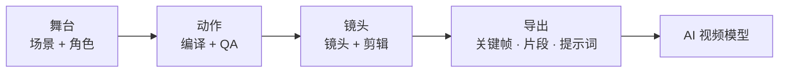

<p align="center">
  
</p>

<p align="center">
  <b>先搭好场景，再把它变成视频。</b><br>
  <em>在浏览器标签页中进行开源预演：搭好舞台、安排角色、设计镜头、剪辑分镜，然后把同一组镜头交给 AI 视频模型。</em>
</p>

<p align="center">
  <a href="LICENSE"></a>
  <a href="https://www.npmjs.com/package/cozyclay"></a>
  
  <a href="https://github.com/NomaDamas/CozyClay/stargazers"></a>
  <a href="https://discord.gg/Hp9V5wwgjF"></a>
</p>

<p align="center">
  <a href="https://cozyclay.org/#try">在浏览器中试用</a> ·
  <a href="#quick-start">快速开始</a> ·
  <a href="INSTALL_FOR_AGENTS.md">面向 AI Agent 的指南</a> ·
  <a href="#docs">文档</a> ·
  <a href="CHANGELOG.md">更新日志</a> ·
  <a href="https://discord.gg/Hp9V5wwgjF">Discord</a>
</p>

<table>
  <tr>
    <td width="50%"><video src="https://github.com/user-attachments/assets/00f28c2f-e8e2-43eb-b253-b6c2436e1818" controls muted width="100%"></video></td>
    <td width="50%"><video src="https://github.com/user-attachments/assets/4c9b1e29-4803-435c-8305-f2c899fb1c2c" controls muted width="100%"></video></td>
  </tr>
  <tr>
    <td align="center"><sub>上图：在 CozyClay 中搭建的灰盒场景。下图：基于它生成的 AI 视频。</sub></td>
    <td align="center"><sub>同样的思路，针对跑酷跳跃动作：分镜与节奏都由灰盒版块来固定，镜头也一并保留。</sub></td>
  </tr>
</table>

## 为什么值得用

AI 视频每次生成都要付费，一旦方向偏了，就要再掏一轮预算。文本提示词无法承载完整场景：每个人站在哪里、如何移动、镜头摆在何处、何时切换镜头，这些都需要明确表达。

CozyClay 让你先在 3D 场景中做出这些决策，修改成本低，而且高效可迭代。随后，视频模型将获得一帧起始画面、灰盒参考片段，以及一段描述真实构图的提示词。它不会靠猜测，而是遵循你已经确定好的分场和动作。



## 快速开始

```bash
npx cozyclay
```

这就是全部安装步骤。你只需要 Node.js 22.19 或更高版本，以及一个 Chromium 浏览器；不需要 GPU、Python，也不需要下载模型。工作室会在 `http://127.0.0.1:5180/app/` 打开。

**更新。** 运行 `npx cozyclay` 时会自动拉取最新版本。若执行过 `npm install -g cozyclay`，工作室顶部栏会显示一个小型 **Update** 更新提示，提示有新版本可用。点击 **Update now** 即可安装更新，然后重启 `cclay`。在终端中执行 `cclay update` 也能完成相同操作。`--no-update-check` 或 `COZYCLAY_NO_UPDATE_CHECK=1` 可以关闭更新检查。

> **想让 AI Agent 帮你搭环境？** 把这个仓库链接发给它即可。它的说明在
> [`INSTALL_FOR_AGENTS.md`](INSTALL_FOR_AGENTS.md)。

## 你可以做什么

| | |
| --- | --- |
| **舞台构建** | 从基础几何体搭建场景。添加绑定骨骼的角色，或者在没有人需要移动四肢时使用胶囊替身。像 3D 编辑器一样自由飞行视角。 |
| **动作设计** | 描述你想要的动作。AI Agent 会生成动作脚本，而浏览器中的确定性编译器会把每一帧烘焙出来。质量检查会在你提交前验证碰撞、脚步滑移、可触达性和手部接触。 |
| **镜头拍摄** | 把镜头放进时间线，绘制滑轨，透过镜头观察场景。每个镜头都知道目标视频模型所允许的限制。 |
| **导出** | 关键帧包（首尾帧、灰盒片段、镜头、提示词）、MP4、深度图和法线图、分镜图、OTIO 剪辑列表。 |
| **故事板** | 更偏好静态分镜？故事板项目可作为一排面板，以字幕、动画分镜和分镜图的形式呈现。 |
| **任意撤销** | 每一次编辑，包括 Agent 做出的每一处修改，都会作为一个独立的撤销步骤。 |

## 让 AI 来指挥

同一个场景可以从三个入口驱动，并且在你观看视口时实时生效。

| 界面 | 启动方式 | 适用场景 |
| --- | --- | --- |
| **Agent 面板** | 在工作室中按 `Cmd/Ctrl+B` | 在工作室内聊天。可使用 ChatGPT 登录，或接入你自己的键（Anthropic、OpenAI、Gemini、MiniMax、OpenRouter、CLIProxyAPI）。 |
| **MCP server** | `npx -y cozyclay mcp` | Claude Desktop、Claude Code、Cursor 或其他 MCP 客户端。 |
| **终端** | `cclay live status --wait` | 驱动正在运行的工作室的编程代理，输入输出为 JSON。 |

```json
{ "mcpServers": { "cozyclay": { "command": "npx", "args": ["-y", "cozyclay", "mcp"] } } }
```

## 从源代码运行

```bash
git clone https://github.com/NomaDamas/CozyClay.git && cd CozyClay
npm install
npm run dev     # http://127.0.0.1:5180/app/
npm test
```

## 文档

| 阅读对象 | 用途 |
| --- | --- |
| [`INSTALL_FOR_AGENTS.md`](INSTALL_FOR_AGENTS.md) | 安装、运行和连接的说明，专为 AI Agent 编写 |
| [`docs/motion3-agent-guide.md`](docs/motion3-agent-guide.md) | 动作规范、编译与质量检查 |
| [`docs/agent-cli.md`](docs/agent-cli.md) | `cclay live`、模型提供商、会话说明 |
| [`mcp/README.md`](mcp/README.md) | MCP 工具与实时协议 |
| [`docs/studio-ui-ia.md`](docs/studio-ui-ia.md) | 每个控制项及其所在位置 |
| [`docs/privacy.md`](docs/privacy.md) | 匿名遥测与关闭方式（`cclay telemetry off`） |
| [`AGENTS.md`](AGENTS.md) | 贡献规则 |

## 指南

| 阅读对象 | 用途 |
| --- | --- |
| [Greybox to AI video](https://cozyclay.org/greybox-to-video/) | 为什么灰盒分镜是对 AI 视频模型最可靠的输入，以及“先搭框架再生成”的闭环过程 |
| [Previs software compared](https://cozyclay.org/previs-software/) | 开源且基于浏览器的预演软件横向对比 |
| [Seedance 2.5 camera control](https://cozyclay.org/seedance-camera-control/) | 如何让同一镜头在每次拍摄中保持一致，使用参考片段来控制摄像机 |
| [Camera control for AI video](https://cozyclay.org/ai-camera-control/) | 为什么相机提示词会漂移，以及模型真正接受的输入是什么 |

发现 bug 或想提新功能？[提交 issue](https://github.com/NomaDamas/CozyClay/issues)。

## 许可证

AGPL-3.0-or-later。详见 [`LICENSE`](LICENSE)、[`LICENSING.md`](LICENSING.md) 和 [`THIRD_PARTY_NOTICES.md`](THIRD_PARTY_NOTICES.md)。由 [Doyun](https://github.com/HaD0Yun) 在 [NomaDamas](https://github.com/NomaDamas) 创作。
